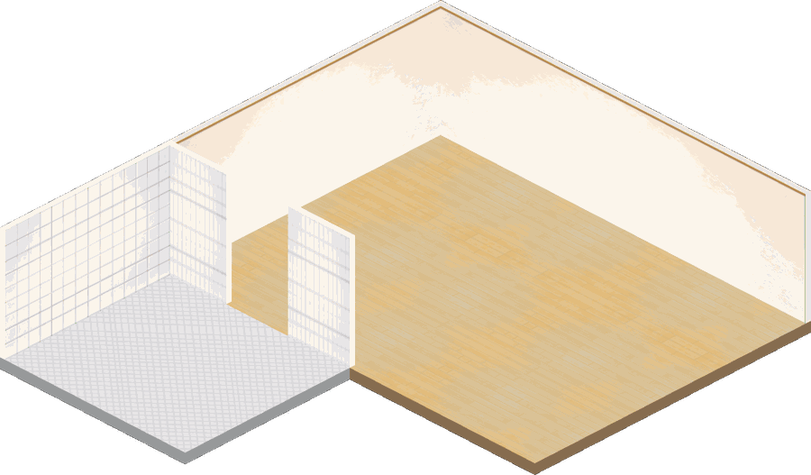

# 一个小房间（2D 房间 + 会走路的角色）

一个跑在浏览器里的**等距小房间**：一张画好的屋子图当底，家具和角色都是贴图；
角色会在屋里自己走、绕开家具；点地板走过去、点家具做动作、点她说话。

整个东西是**纯前端**（一个 HTML + 几张 PNG），后面能接后端，也能单独跑。



---

## 它长什么样 / 怎么跑

**方式一：直接静态托管（最简单）**

```bash
# 在仓库根目录起个静态服务器
python -m http.server 8000
# 然后打开
http://localhost:8000/room/
```

这时是「纯画面」：能走、能点、能换动作，但**不会说话**（说话要靠后端）。

**方式二：挂到自己的服务端上**

把 `room/` 放到 `https://你的域名/room/<房号>/` 下，素材路径自动变成
`/room/<房号>/obj/*.png`，并会去请求 `/room/<房号>/api/*`：

```
POST api/say     {text}                       让她说一句
GET  api/state   → {x, y, facing, sleeping}   她在哪
POST api/state   {x, y}                       上报位置
GET  api/fridge  → {balance:{total}}          冰箱面板读的数据
```

接口想接什么都行：接一个大模型、接一个前台页面、接一个只会说"嗯"的机器人。

---

## 里面有什么

```
room/index.html        全部逻辑（约 30 KB，无框架，2D canvas）
assets/room/*.png      屋子底图 + 家具 / 动作图
assets/character/      角色：正面 / 侧面 / 背面 / 走路帧
tools/key_green.py     绿幕抠图（边缘泛洪版，见 tools/README.md）
```

**没有构建步骤**，改完刷新就是。

---

## 四个编辑工具（URL 参数）

摆位置这种事，**不要用数值猜**，用工具拖：

| 参数 | 作用 |
|---|---|
| `?edit=1` | 摆家具：拖动移位、滚轮缩放、松手复制坐标 |
| `?zone=1` | 圈可走区域：点着圈，回车收一块，`C` 撤销整块，`Z` 退一个点 |
| `?act=bed` | 调某件的动作图：拖动改偏移、滚轮改缩放（`bed/pcdesk/table/tub/sink`）|
| `?shot=1` | 导出屋子底图（页面里换成 three.js 那版时用）|

坐标单位就是**图片像素**，锚点是**脚下中心**。写进 `room/index.html` 的 `FURN` 里：

```js
{ id:'bed', tex:'bed_empty', act:'act_bed', actScale:1.15,
  x:631, y:292, w:175, label:'床' }
```

---

## 走路怎么算的

- 可走区域 = 若干多边形（`WALK_POLYS`），点在里面才走得了
- 建一张 10 像素的网格，**闭运算**把相邻多边形之间的窄缝桥接起来，否则各块互不连通
- 网格上跑 A*（八方向、对角代价 1.414），沿路径逐点走
- 判定点必须和建网格用的点完全一致，否则会"走一步被判出界 → 拉回来"来回抖

---

## 素材规格（想换自己的角色就照这个做）

```
视角     等距 2:1，相机方位 45°，俯角约 30°
一致性   同一画布尺寸、同一身高、双脚落在同一条水平线上
背景     纯绿底（#00c040 一类），无影子、无文字、不要贴边
命名     front / side / back / walk1..8 / backwalk1..8
```

抠图用 `tools/key_green.py`，**不要**直接一刀切阈值（会把白色物件的阴影吃掉）。

---

## 许可

- **代码**（`room/index.html`、`tools/`）：MIT，见 [LICENSE](LICENSE)
- **素材**（`assets/`）：见 [NOTICE.md](NOTICE.md) —— 与代码分开授权。
  角色形象是社区二创「鲸鱼娘」，上游参考
  [TreapGoGo/deepseek-whale-girl](https://github.com/TreapGoGo/deepseek-whale-girl)
  （MIT，非官方社区项目）。本仓库的图属二次创作，**仅限非商业使用**。

---

## 已知限制

- 角色只有三个朝向（正 / 侧 / 背），没有八方向立绘，快速转向时会有点生硬
- 没有行走循环动画，走路是"单张站立图 + 轻微上下浮动"
- 房间是**一张烤好的图**，不能转视角；想要自由转视角得走真 3D
